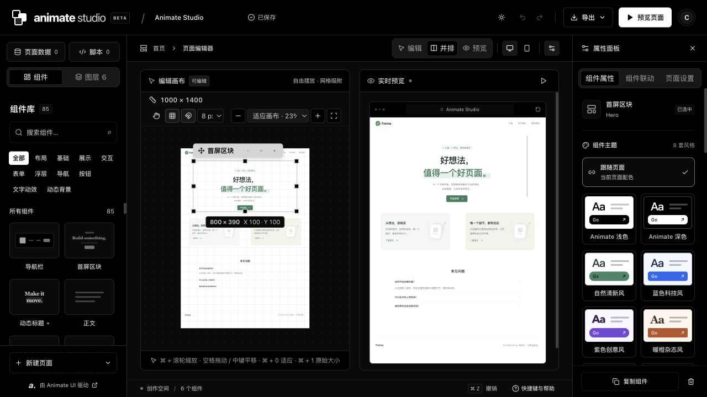

# Animate Studio

**当前版本：[v2026.10.23](https://github.com/kiritoko1029/animate-studio/releases/tag/v2026.10.23)** · [更新日志（中文 / English）](CHANGELOG.md)

**自由搭建页面，编写交互脚本，直接导出前端代码。**

[在线体验](https://animate-studio.vme5.de/) · [English](README.md) · **简体中文** · [详细使用指南](docs/user-guide.zh-CN.md)

品牌标识「跃帧 / Keyframe A」的设计来源、图标素材和生成方式见 [品牌规范](docs/brand-guidelines.md)。



把组件放到画布上，调整内容和外观，通过共享变量与事件连接组件。边搭建边预览，完成后导出 HTML、Vue、React 或可继续编辑的页面 JSON。

## 功能

- **自由画布**：拖动、八方向缩放、网格吸附、图层管理、撤销重做，以及围绕鼠标位置的 5%–400% 视野缩放。
- **85 种组件**：覆盖布局、表单、内容展示、导航、浮层、按钮、文字动效和动态背景，支持中英文搜索。
- **主题设计**：黑白工作台浅色/深色切换、8 套页面预设、组件独立主题，以及自定义主题设计器。
- **组件联动**：共享变量、属性绑定、表达式、条件动作、点击与值变化事件。表达式提示会使用当前页面已有变量。
- **JavaScript 编辑器**：代码高亮、自动补全、语法检查、测试运行和调试日志；内置 `ctx.fetchJSON`、`ctx.setState`、`ctx.notify`、`ctx.sleep` 等函数。
- **可移植代码导出**：导出独立 HTML 或内嵌页面的 Vue/React 包装组件，无需额外安装 Animate UI、Motion、Radix 或 Tailwind；页面 JSON 可用于继续编辑。
- **账号与云端页面**：邮箱验证码、GitHub 登录，多页面保存、只读分享链接与个人外观同步；访客仍可自由编辑和导出。
- **本地与云端部署**：Express 支持 SQLite / PostgreSQL，Cloudflare 使用 D1；账号与邮件配置见 [接入指南](docs/accounts-and-storage.md)。

工作台控件与画布原语已使用 `@animate-ui/react` 2.0.0（npm 最新版）和 Motion 14.5.0；背景与样式按钮固定使用 Animate UI v2.1.2 的 Registry 源码。画布、普通预览和带联动的预览共用官方 React 原语与默认动效；属性面板可调整官方支持的效果参数。下载的 HTML 内嵌同一运行时，Vue/React 组件通过 iframe 承载该独立页面。详见 [版本记录](docs/animate-ui-version.json) 和 [组件覆盖说明](docs/animate-ui-coverage.md)。

自定义组件：在 **组件 → 我的组件** 中编写 HTML、CSS、JavaScript，使用模板、实时预览和编写指南。支持本机保存、登录后保存到账号与发布组件分享；插入页面的是独立副本。见 [自定义组件指南](docs/custom-components.zh-CN.md)。

## 快速开始

需要 **Node.js 24.21.0+**。项目的 `.nvmrc` 与 CI 使用 Node.js 24.22.0。

```sh
git clone https://github.com/kiritoko1029/animate-studio.git
cd animate-studio
npm ci
npm run dev
```

打开 **http://127.0.0.1:4173**。本地服务默认仅监听本机地址。访客草稿自动保存到浏览器；配置登录后可将页面保存到账号数据库，刷新后恢复。

构建并运行本地生产版本：

```sh
npm run build
NODE_ENV=production npm start
```

## 创建第一个页面

1. 从组件库添加组件，在画布上拖动位置、调整大小。
2. 在右侧属性面板修改文字、外观、布局和主题。
3. 打开 **页面数据** 定义变量，在 **组件联动** 中连接属性和事件。
4. 在预览区域测试交互，再通过 **导出** 下载代码或页面 JSON。

工作台支持简体中文和 English，可在顶部「更多（⋯）→ 语言」中切换；新建、导入和导出统一收进「页面」菜单。首次访问跟随浏览器语言（中文语种使用简体中文，其他语言使用英文），选择会保存在当前浏览器中。切换语言保留页面内容与撤销记录。表达式、事件动作、脚本、主题和导出接入的完整说明已整理到 [详细使用指南](docs/user-guide.zh-CN.md)。

| 画布操作 | macOS | Windows / Linux |
| --- | --- | --- |
| 围绕鼠标缩放 | `⌘` + 滚轮 | `Alt` + 滚轮 |
| 适应画布 | `⌘` + `0` | `Alt` + `0` |
| 恢复 100% | `⌘` + `1` | `Alt` + `1` |
| 平移 | 空格 + 拖动，或中键拖动 | 空格 + 拖动，或中键拖动 |
| 撤销 / 重做 | `⌘ Z` / `⌘ ⇧ Z` | `Ctrl Z` / `Ctrl Shift Z` |

## 导出格式

| 格式 | 输出 | 使用条件 |
| --- | --- | --- |
| HTML | 包含 CSS 与 JavaScript 的单个 `.html` 文件 | 浏览器或静态服务器，无需构建 |
| Vue | `GeneratedPage.vue` | 支持单文件组件的 Vue 3.5+ 项目 |
| React | `GeneratedPage.jsx` | 支持 JSX 的 React 18+ 项目 |
| JSON | 完整页面定义 | 导回 Animate Studio 继续编辑 |

导出会携带布局、主题、变量绑定、事件和脚本。设计画布按容器宽度等比缩放，不自动转换为移动端重排。自定义图片保留 URL，需要在目标环境中继续可用。代码文件不能反向导入编辑器，继续编辑请保留 JSON。

脚本在隔离的 iframe / Worker 中执行，单次运行上限 15 秒；HTTP 请求遵循浏览器 CORS 规则，不提供 DOM 访问或 npm 包导入。

## 发布到 Cloudflare

[Void](https://void.cloud/guide/quickstart) 会一起构建并发布前端、API 和持久化存储：

```sh
npm run cloudflare:login
npm run deploy:cloudflare
```

云端模式的本地开发与预览：

```sh
npm run dev:cloudflare      # 本地开发，端口 4174
npm run build:cloudflare    # 构建 Worker 与前端
npm run preview:cloudflare # 在本机运行云端构建
```

访客草稿保存在浏览器，登录后的页面、分享快照和设置保存在 D1。旧匿名 Durable Object 工作区可恢复为浏览器草稿，原存储与迁移历史保留。Resend、GitHub OAuth、PostgreSQL 和迁移步骤见 [账号与存储指南](docs/accounts-and-storage.md)。本地页面不会自动上传。

[GitHub Actions](.github/workflows/cloudflare.yml) 会对 pull request 和 `main` 执行测试与构建。在仓库配置 `CLOUDFLARE_API_TOKEN` Secret 后，`main` 验证通过即可自动发布；未配置时只验证，并明确跳过发布。可以先使用本机登录发布，之后再启用自动发布。

请将 `void.lock.json` 纳入 Git，保留资源标识和迁移历史。账号变量、Token 权限、数据保存和故障排查见 [Cloudflare 发布指南](docs/cloudflare-deployment.md)。

## 开发与验证

```sh
npm test             # 编辑器、脚本运行时、API 和代码导出测试
npm run typecheck    # 分别检查浏览器与 Cloudflare 类型
npm run build        # 本地 Node.js 版本的前端构建
npm run build:cloudflare
```

测试使用隔离 DOM、临时目录与临时服务，不修改 `data/page.json`。两种构建共用 `dist/`，启动生产预览前请先执行对应构建。

| 目录 | 职责 |
| --- | --- |
| `src/components/` | 画布、属性面板、脚本编辑器和工作台控件 |
| `src/lib/code-export/` | 共享导出结构及 HTML/Vue/React 生成器 |
| `shared/` | 页面校验规则、主题定义和交互运行时 |
| `server/` | 本地 Express API、数据校验与云端 API 适配 |
| `routes/`、`durable-objects/` | Void 路由与浏览器独立的持久化状态 |
| `tests/` | 自动化行为与集成测试 |

## 许可证与致谢

本项目参照 [Animate UI 的许可证](https://github.com/imskyleen/animate-ui/blob/main/LICENSE.md)，采用 **MIT + Commons Clause License Condition**。完整条款见 [LICENSE.md](LICENSE.md)。

允许作为应用、网站或产品的一部分使用、修改和分发，包括商业用途；**限制将原始组件本身单独出售或再分发，无论独立提供还是打包提供。** 本许可证并非未附加条件的标准 MIT 许可证。

Animate UI 源码保留其原始版权及许可证声明，其他第三方依赖继续适用各自的许可证，详见 [THIRD_PARTY_NOTICES.md](THIRD_PARTY_NOTICES.md)。
