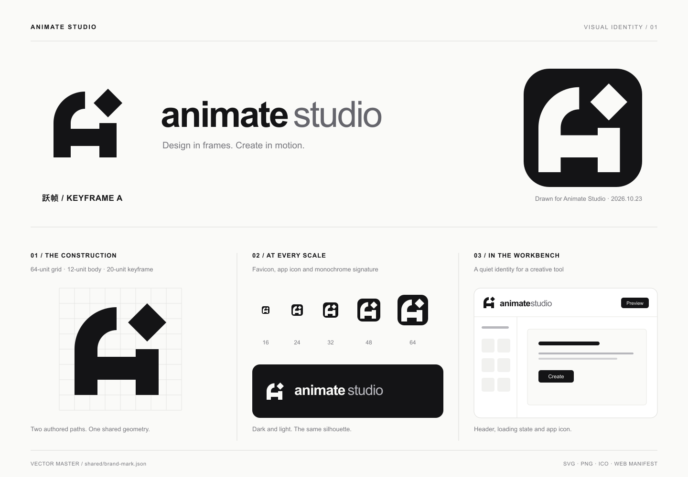

# Animate Studio 品牌标识

## 跃帧 / Keyframe A

设计日期：2026-10-23。该图形为本次 Animate Studio 品牌任务从空白网格绘制，设计与矢量实现由 Codex 完成。



标识用两部分表达产品：弧形骨架构成抽象的 **A**，也像正在搭建的页面框架；右上角悬起的菱形来自动画时间轴中的**关键帧**概念。弧线表达连续变化，直线与横梁表达可视化布局。两部分之间的留白让运动感在静态、小尺寸和单色环境中仍然成立。

本次没有取用、描摹或修改现成 Logo、图标库路径或图片素材。早期推敲包含关键帧 A、开放画框、折叠路径和折角 A 四个方向，最终选用关键帧 A。这里记录的是本次创作来源，不代表已经完成商标或全球近似标识检索。

## 唯一几何源

- [共享几何源](../shared/brand-mark.json)：64 × 64 坐标系中的两个自绘路径、色值与设计名称。
- [页面品牌组件](../src/components/Brand.tsx)：直接读取几何源，用 `currentColor` 适配工作台明暗主题。
- [生成脚本](../scripts/generate-brand-assets.mjs)：由同一份路径生成 SVG、PNG、ICO 和安装图标。

修改几何源后执行：

```sh
npm run brand:generate
```

不要单独修改生成的 SVG 或 PNG，以免页面 Logo 与 favicon 再次分叉。

## 图形规范

- 画布：64 × 64；图形外接范围为 x=8…56、y=8…56。
- 主干厚度：12；菱形宽高：20。
- 关键帧与右侧骨架的垂直间隔：4；保留这个间隔，不把两者连接。
- 常规标识保留至少 8 单位的四周留白。紧凑界面最小使用 24px 的画布；16px 标签页使用专门导出的 favicon。
- 等比例缩放，不压扁、倾斜、旋转或给图形增加描边、渐变与投影。
- 独立素材和 favicon 保持静态。页面组件仅让右上角关键帧运动，A 的骨架保持稳定。

## 页面动效

- **加载**：关键帧在 1.6 秒内上浮 4 个 SVG 单位并回落，循环播放。真实加载结束即进入工作台，不为了动画延长等待。
- **悬浮**：关键帧跃起 6 个单位、旋转 90° 后落位，480ms 播放一次。持续悬浮不会重复；触屏不会模拟悬浮。
- **加载完成**：工作台出现时播放一次 420ms 的轻微落位回弹。
- **中途移开**：从当下可见位置平滑回到静止位置，180ms，不跳回起点。
- 加载失败时停止循环；标签页隐藏时暂停；组件卸载时释放动画与监听器。
- 系统开启“减少动态效果”后立即恢复静态，加载文字仍然可用。

动效位移以 64 单位画布计算；例如 32px 页头标识的悬浮上移只有 3px。实现见 [动效控制器](../src/lib/brand-motion.ts)。

## 色彩与字体

| 用途 | 色值 |
| --- | --- |
| 主色 / Ink | `#141416` |
| 反白 / Paper | `#FAFAF8` |
| 浅色组合标的 studio 字样 | `#65656C` |
| 深色组合标的 studio 字样 | `#B9B9BF` |

品牌词采用小写 **animate studio**，animate 使用粗字重，studio 使用常规字重。工作台沿用系统无衬线字体；下载用组合 SVG 指定 Arial / Helvetica 回退。字体本身不是本次原创设计，也不随素材包分发字体文件；跨平台印刷前应由设计软件使用合法字体转曲。

## 文件用途

| 文件 | 用途 |
| --- | --- |
| [mark.svg](../public/brand/mark.svg) / [mark.png](../public/brand/mark.png) | 浅色背景上的透明主标识 |
| [mark-inverse.svg](../public/brand/mark-inverse.svg) / [mark-inverse.png](../public/brand/mark-inverse.png) | 深色背景上的透明反白标识 |
| [lockup.svg](../public/brand/lockup.svg) / [lockup-inverse.svg](../public/brand/lockup-inverse.svg) | 横向图文组合标 |
| [app-icon.svg](../public/brand/app-icon.svg) / [app-icon.png](../public/brand/app-icon.png) | 黑底反白应用图标，PNG 为 1024 × 1024 |
| [favicon.svg](../public/favicon.svg) / [favicon.ico](../public/favicon.ico) | 浏览器标签；ICO 含 16、32、48px 三档 |
| [apple-touch-icon.png](../public/apple-touch-icon.png) | Apple 主屏幕图标，180 × 180 |
| [icon-192.png](../public/brand/icon-192.png) / [icon-512.png](../public/brand/icon-512.png) | Web Manifest 应用图标 |
| [icon-maskable-512.png](../public/brand/icon-maskable-512.png) | 可裁切图标，标识处于中心安全圆内 |

品牌形状的最外点位于 64 单位画布的安全区；maskable 版本进一步缩小到 75%，最大距中心约 25.5，小于平台要求的 25.6 单位安全半径。

## 来源与第三方边界

以上品牌图形是本项目新绘制的资产，沿用项目许可证。应用的操作图标仍由其原有图标库提供，并遵守对应许可证；不得把第三方操作图标声明为本次原创品牌作品。参见 [第三方声明](../THIRD_PARTY_NOTICES.md)。
